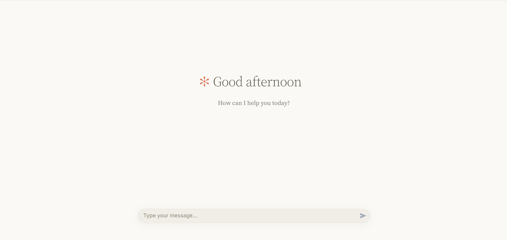
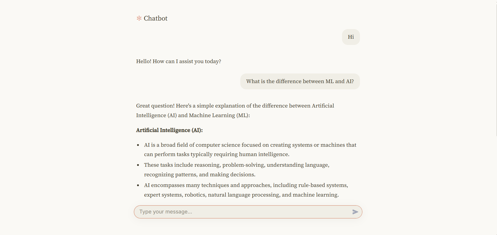

# Simple Chatbot (Azure AI Foundry + gpt-4.1-mini)

A clean, minimal chatbot built with Streamlit. It uses the **gpt-4.1-mini** model
deployed in Azure AI Foundry through the OpenAI Responses API. Answers stream in as they
are written, and the bot remembers the conversation, so follow-up questions work.

## Screenshots
<p align="center">
  
  
</p>

## Features
- Streaming answers
- Conversation memory
- Clean, Claude-inspired interface (warm colours, serif text)
- Refresh the page to start a new chat

## Requirements
- Python 3.9 or newer
- An Azure AI Foundry resource with a **gpt-4.1-mini** deployment

## Setup
1. Install the dependencies:
   ```
   pip install -r requirements.txt
   ```
2. Create a file named `.env` in this folder (copy `.env.example`) and fill in your values:
   ```
   AZURE_OPENAI_BASE_URL=https://<your-resource>.services.ai.azure.com/openai/v1/
   AZURE_OPENAI_API_KEY=your-key-here
   CHAT_DEPLOYMENT=gpt-4.1-mini
   ```
   - The base URL must end with `/openai/v1/` (do not add `/responses`).
   - `CHAT_DEPLOYMENT` must match the deployment name shown in Foundry.
   - Never share or commit `.env`.

## Run
```
streamlit run chatbot.py
```
Then open http://localhost:8501 in your browser.

## Project files
| File | Purpose |
|---|---|
| `chatbot.py` | The chatbot app |
| `.streamlit/config.toml` | Theme (colours) for the interface |
| `requirements.txt` | Python dependencies |
| `.env.example` | Template for your settings |
| `screenshot-home.png`, `screenshot-chat.png` | Images shown in this README |
| `.gitignore` | Keeps `.env` and other files out of git |

## Troubleshooting
| Error | Fix |
|---|---|
| `KeyError: 'AZURE_OPENAI_API_KEY'` | The `.env` file is missing, misnamed (e.g. `.env.txt`), or not in the same folder as `chatbot.py` |
| `DeploymentNotFound` (404) | `CHAT_DEPLOYMENT` does not match your deployment name in Foundry |
| 401 error | The API key is wrong or was regenerated |