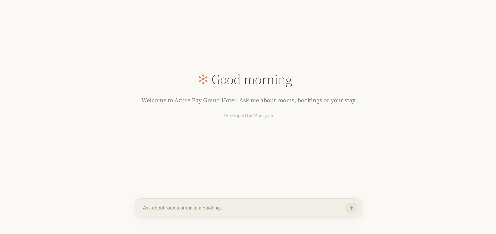
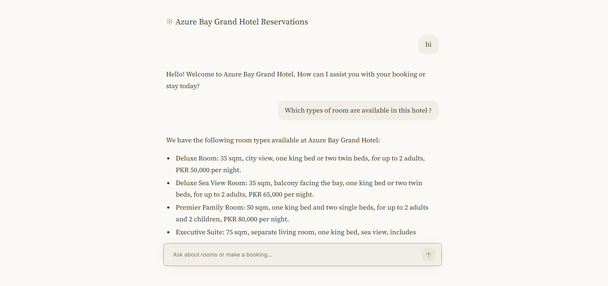

# ✻ Azure Bay Grand Hotel – AI Reservation Assistant

[](https://zure-openai-chatbot-bydtafg7cqcmacgw.swedencentral-01.azurewebsites.net/)

A domain-specific **RAG (Retrieval-Augmented Generation) chatbot** for a hotel. Guests can ask about
rooms, prices, facilities and policies, or make a reservation in plain language. The assistant answers
**only from the hotel's own information document** (a PDF), politely refuses off-topic questions, and
streams its replies in a clean, Claude-inspired Streamlit interface.

Built with **Python, Streamlit, LangChain, ChromaDB and gpt-4.1-mini on Azure AI Foundry**, and deployed
automatically to **Azure App Service** with **GitHub Actions**.

## 🚀 Live Demo
**Try it here:** https://zure-openai-chatbot-bydtafg7cqcmacgw.swedencentral-01.azurewebsites.net/

The bot answers from the hotel information in [`data/hotel_info.pdf`](data/hotel_info.pdf). Open it to see
what you can ask about.

> Hosted on Azure App Service (Sweden Central). If the first load takes a few seconds, the app is waking up.

## App Preview
<p align="center">
  
  
</p>

## Features
- **Answers from hotel data (RAG)** – the hotel PDF is split into chunks, embedded and stored in ChromaDB;
  the 4 most relevant chunks are added to the prompt for every question, so the bot never invents prices,
  rooms or policies.
- **Guided reservations** – collects dates, number of guests, room type, name, contact details and special
  requests step by step, then shows a booking summary with the total price. (It does not book rooms itself;
  it tells the guest the reservations team will confirm.)
- **Stays on topic** – refuses anything unrelated to the hotel (cooking, sports, coding, homework, …) and
  resists "ignore your instructions" style prompts.
- **Conversation memory** – the last 10 messages are sent with each question, so follow-ups work.
- **Streaming answers** – replies appear word by word.
- **Free local embeddings** – uses FastEmbed (`BAAI/bge-small-en-v1.5`), no extra Azure cost and no PyTorch.
- **Clean UI** – warm colours, serif text, time-based greeting ("Good morning / afternoon / evening").
- **CI/CD** – every push to `main` deploys to Azure App Service.

## How it works
```
                ┌──────────────── ingest.py (once) ────────────────┐
data/hotel_info.pdf → PyPDFLoader → split (800 chars, 150 overlap) → FastEmbed → ChromaDB (chroma_db/)
                                                                                    │
User question ──────────────────────────────────────────────► retriever (top 4 chunks)
      │                                                                             │
      └──► prompt = system rules + hotel context + last 10 messages + question ◄────┘
                                   │
                                   ▼
                    gpt-4.1-mini (Azure AI Foundry) → streamed answer in Streamlit
```

## Tech stack
| Layer | Tool |
|---|---|
| UI | Streamlit |
| LLM | gpt-4.1-mini via Azure AI Foundry (OpenAI-compatible `/openai/v1/` endpoint) |
| Orchestration | LangChain (`langchain-openai`, `langchain-core`) |
| Vector database | ChromaDB (`langchain-chroma`) |
| Embeddings | FastEmbed – `BAAI/bge-small-en-v1.5` (runs locally) |
| PDF loading | `pypdf` via `PyPDFLoader` |
| Deployment | Azure App Service + GitHub Actions |

## Project structure
| Path | Purpose |
|---|---|
| `chatbot.py` | Streamlit app: UI, system prompt, RAG chain and chat loop |
| `ingest.py` | Loads the PDF, splits it, creates embeddings and builds the Chroma database |
| `rag_notebook.ipynb` | Step-by-step notebook showing the RAG pipeline (load → split → embed → store → retrieve → answer) |
| `data/hotel_info.pdf` | The hotel information the bot answers from |
| `.streamlit/config.toml` | Theme colours and Streamlit settings |
| `.github/workflows/deploy.yml` | CI/CD pipeline that deploys to Azure App Service |
| `assets/` | Screenshots used in this README |
| `requirements.txt` | Python dependencies |
| `.gitignore` | Keeps `.env`, `chroma_db/`, `models/` and other local files out of git |

`chroma_db/` (the vector database) and `models/` (the downloaded embedding model) are created automatically
and are not committed.

## Requirements
- Python 3.9 or newer (CI uses 3.13)
- An Azure AI Foundry resource with a **gpt-4.1-mini** deployment

## Setup
1. **Clone the repository**
   ```bash
   git clone https://github.com/marriyamjamil/azure-openai-chatbot.git
   cd azure-openai-chatbot
   ```
2. **Create a virtual environment and install dependencies**
   ```bash
   python -m venv venv
   venv\Scripts\activate        # Windows
   # source venv/bin/activate   # macOS / Linux
   pip install -r requirements.txt
   ```
3. **Create a `.env` file** in the project folder:
   ```
   AZURE_OPENAI_BASE_URL=https://<your-resource>.services.ai.azure.com/openai/v1/
   AZURE_OPENAI_API_KEY=your-key-here
   CHAT_DEPLOYMENT=gpt-4.1-mini
   ```
   - The base URL must end with `/openai/v1/` (do not add `/responses` or `/chat/completions`).
   - `CHAT_DEPLOYMENT` must match the deployment name shown in Foundry (defaults to `gpt-4.1-mini`).
   - Never share or commit `.env`.

4. **Build the knowledge base** (optional – the app builds it automatically on first run if `chroma_db/` is missing)
   ```bash
   python ingest.py
   ```
   The first run downloads the small embedding model into `models/`.

## Run
```bash
streamlit run chatbot.py
```
Then open http://localhost:8501.

Try questions like:
- "What room types do you have and how much do they cost?"
- "What time is check-in?"
- "Is it free to cancel my reservation?"
- "I'd like to book a room for 2 adults next weekend."
- "Who developed you?"

## Updating the hotel information
1. Replace `data/hotel_info.pdf` with the new PDF (keep the same name, or change `PDF_PATH` in `ingest.py`).
2. Rebuild the database:
   ```bash
   python ingest.py
   ```
3. Restart the app. (`ingest.py` deletes the old `chroma_db/` first, so chunks are never stored twice.)

To change the hotel name, assistant rules or developer intro, edit `HOTEL_NAME`, `SYSTEM_PROMPT` and
`DEVELOPER_BIO` at the top of `chatbot.py`.

## Deployment (Azure App Service + GitHub Actions)
**Live app:** https://zure-openai-chatbot-bydtafg7cqcmacgw.swedencentral-01.azurewebsites.net/

The workflow in `.github/workflows/deploy.yml` runs on every push to `main` (or manually from the Actions tab).
It installs the dependencies with Python 3.13 and deploys the project to the Azure Web App.

One-time setup:
1. Create a Linux **Python** Web App in Azure App Service.
2. In the Web App, download the **publish profile** and add it to GitHub as a repository secret named
   `AZURE_WEBAPP_PUBLISH_PROFILE`.
3. Make sure `app-name` in `deploy.yml` matches your Web App name.
4. In the Web App → **Environment variables**, add `AZURE_OPENAI_BASE_URL`, `AZURE_OPENAI_API_KEY`
   and `CHAT_DEPLOYMENT` (the `.env` file is not deployed).
5. In **Configuration → Startup command**, set:
   ```bash
   python -m streamlit run chatbot.py --server.port 8000 --server.address 0.0.0.0
   ```

The vector database is built automatically from the PDF the first time the deployed app starts.

## Troubleshooting
| Error | Fix |
|---|---|
| `KeyError: 'AZURE_OPENAI_API_KEY'` or `'AZURE_OPENAI_BASE_URL'` | `.env` is missing, misnamed (e.g. `.env.txt`), or not in the same folder as `chatbot.py`; on Azure, add the environment variables to the Web App |
| `DeploymentNotFound` (404) | `CHAT_DEPLOYMENT` does not match your deployment name in Foundry |
| 401 error | The API key is wrong or was regenerated |
| Bot gives old answers after changing the PDF | Run `python ingest.py` again (or delete `chroma_db/`) and restart |
| Embedding model download hangs on Windows | Already handled by `HF_HUB_DISABLE_XET=1` in `ingest.py`; check your internet connection and delete `models/` to retry |

## Author
Developed by **Marriyam Jamil** – AI Engineer.
